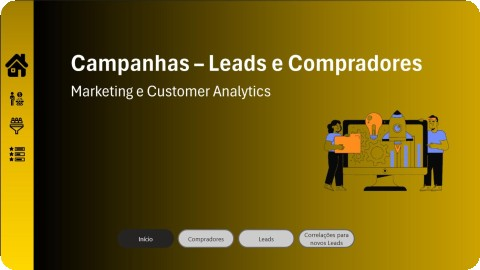
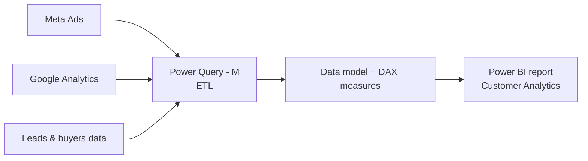
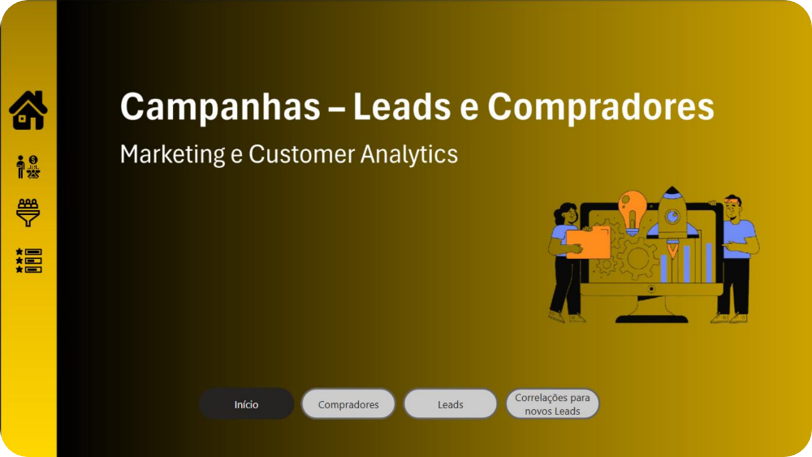
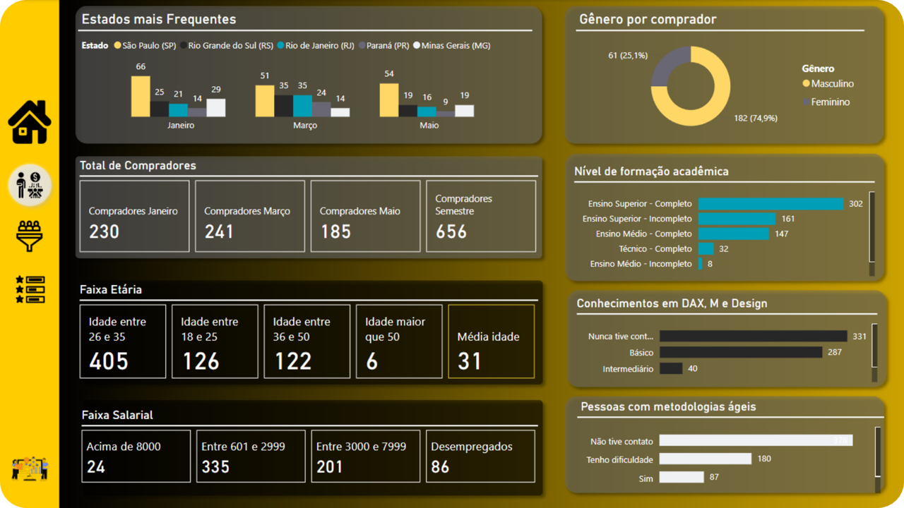
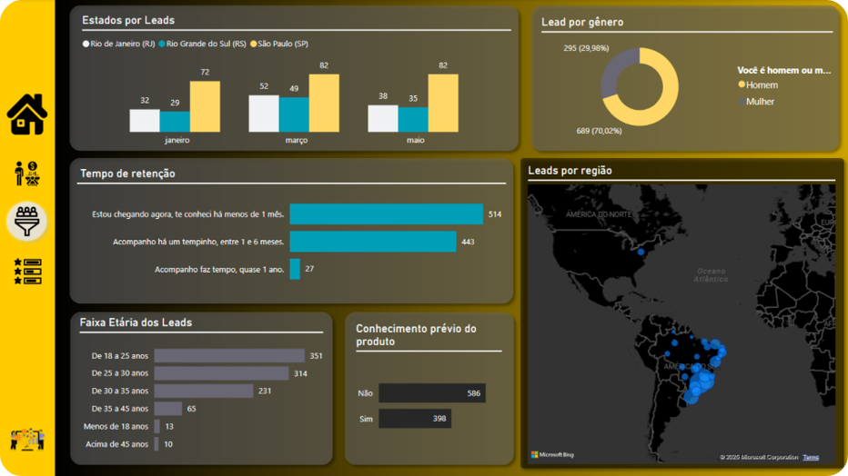

  

  
  
  
  
  
   
  
  
  

## 🎯 The question

> *Who is the best target audience for our next campaigns?*

A report built for the **marketing area** of a digital product. It analyzes **buyer** and **lead** data to find the ideal audience for upcoming campaigns, highlighting the **direct correlation between leads and buyers** and how to leverage that relationship to attract new customers.

## 🔎 What the report answers

- 👥 Who are the **leads** and who actually **buys**?
- 🔗 How strongly do lead characteristics correlate with purchase?
- 📣 Which channels (**Meta Ads**, **Google Analytics** traffic) bring the best leads?
- 🎯 Which profile should the next campaign target?

## 🏗️ Pipeline

## 🛠️ What I did

- **ETL** with Power Query (M) to bring the sources together
- **Data modeling** and **DAX** measures for the lead → buyer analysis
- **Report design** focused on a marketing audience
- Data source: a **CSV refreshed daily** with **Google Analytics 4 (GA4)** extractions

## 🚀 Results

| | |
|---|---|
| 📈 **+10%** | lead conversion through clustering by behavior and traffic source |
| 🎯 **Better targeting** | lead profiles with the highest propensity to convert identified |

## 📸 Dashboard gallery

<table>
  <tr>
    <td width="50%" align="center"> <b>Home</b> · navigation: Buyers, Leads, Correlations</td>
    <td width="50%" align="center"> <b>Buyers</b> · states, gender, age, income, education</td>
  </tr>
  <tr>
    <td width="50%" align="center"> <b>Leads</b> · states, retention, age, region map</td>
    <td width="50%" align="center"> <b>Correlations</b> for new leads</td>
  </tr>
</table>

---

👤 Part of <a href="https://github.com/MatheusFelipePereira">Matheus Felipe Pereira's portfolio</a> · <a href="https://www.linkedin.com/in/matheus-felipe-p/">LinkedIn</a>
